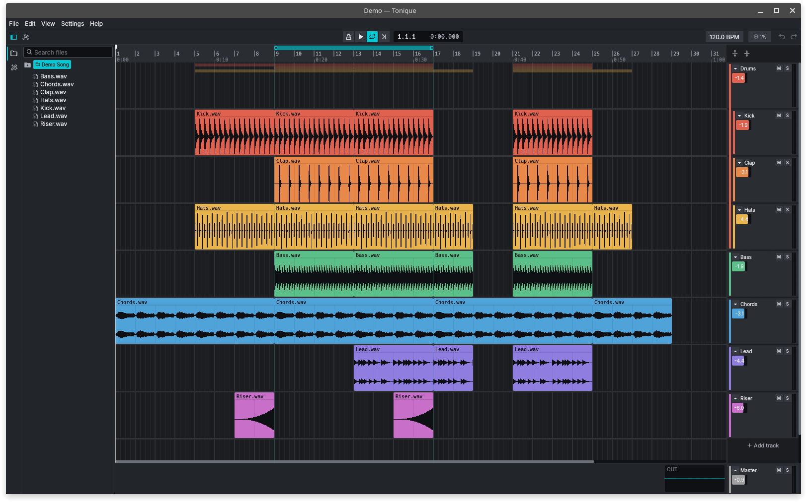

# Tonique DAW [WIP]

A rust based Digital Audio Workstation (DAW).



## Download

Builds for Linux, macOS and Windows are on the
[releases page](https://github.com/rravelli/ToniqueDAW/releases).

- **Linux**: extract the archive and run `./install.sh` (installs into
  `~/.local`). Needs ALSA (`libasound2`), installed on most desktops.
- **macOS**: open the `.dmg` and drag Tonique to Applications. The app isn't
  notarized: the first time, right-click it → **Open**.
- **Windows**: extract the zip and run `Tonique.exe`. It isn't signed: on
  SmartScreen's warning, click **More info → Run anyway**.

See [RELEASING.md](RELEASING.md) to publish a new version.

## Build from source

For linux, install required dependencies from [alsa-sys](https://github.com/diwic/alsa-sys)

### Debian/Ubuntu/Mint

```bash
sudo apt install libasound2-dev
```

### Fedora/Centos

```bash
dnf install alsa-lib-devel
```

### Build and run in dev mode

```bash
cargo run
```

### Build and run in release

```bash
cargo run --release
```

## Tests and coverage

Install required tools:

```bash
rustup component add llvm-tools-preview
cargo install cargo-llvm-cov
```

Tests only

```bash
cargo test
```

Tests and coverage

```bash
cargo llvm-cov --workspace --all-features --html
```

Then coverage report can be found in `target/llvm-cov/html/index.html`

[](https://codecov.io/github/rravelli/ToniqueDAW)

## License

Licensed under either of

- Apache License, Version 2.0 ([LICENSE-APACHE](LICENSE-APACHE))
- MIT license ([LICENSE-MIT](LICENSE-MIT))

at your option.

Unless you explicitly state otherwise, any contribution intentionally submitted
for inclusion in the work by you, as defined in the Apache-2.0 license, shall be
dual licensed as above, without any additional terms or conditions.
